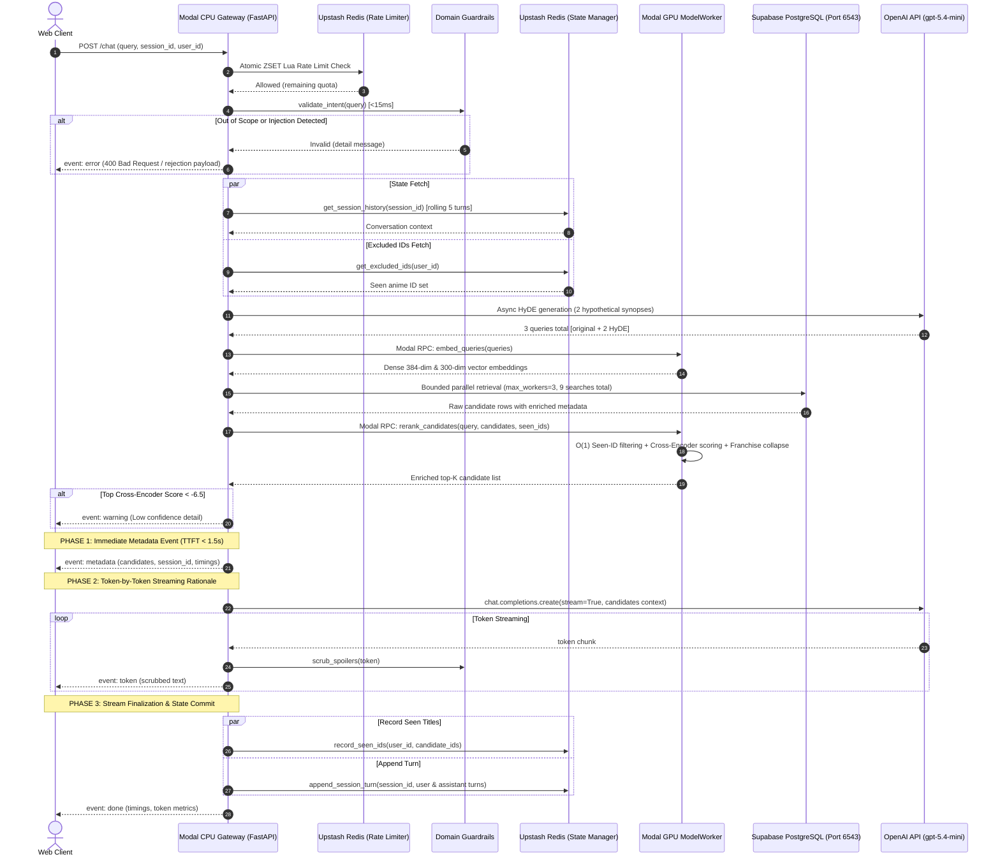

# Architecture

A deep-dive into the technical design, distributed serverless topology, and conversational recommendation pipeline of the Anime Recommender System. For setup instructions and API usage, see [README.md](file:///c:/Dev/anime_recommender/README.md).

---

## Table of Contents

1. [System Architecture](#system-architecture)
   - [Target Decoupled Production Architecture](#target-decoupled-production-architecture)
   - [Conversational Discovery Architecture Flow](#conversational-discovery-architecture-flow)
   - [Data Pipeline Topology](#data-pipeline-topology)
   - [Legacy Headless Recommendation Flow](#legacy-headless-recommendation-flow)
   - [Decoupling & Cost Rationale](#decoupling--cost-rationale)
2. [Project Structure](#project-structure)
3. [Modal Serverless Decoupling & Inference Client](#modal-serverless-decoupling--inference-client)
   - [Gateway Tier: CPU FastAPI Server](#gateway-tier-cpu-fastapi-server)
   - [Inference Tier: GPU ModelWorker Actor](#inference-tier-gpu-modelworker-actor)
   - [Dual-Mode Inference Client Abstraction](#dual-mode-inference-client-abstraction)
4. [Conversational Discovery & Dual-Stream SSE Protocol](#conversational-discovery--dual-stream-sse-protocol)
   - [Endpoint Specification (`POST /chat`)](#endpoint-specification-post-chat)
   - [Dual-Stream SSE Event Specifications](#dual-stream-sse-event-specifications)
   - [Client Disconnection Monitoring](#client-disconnection-monitoring)
   - [Circuit Breaker & Fallback Resilience](#circuit-breaker--fallback-resilience)
5. [Production Domain Guardrails & Active Spoiler Scrubbing](#production-domain-guardrails--active-spoiler-scrubbing)
   - [Multi-Tier Pre-Retrieval Validation (<15ms)](#multi-tier-pre-retrieval-validation-15ms)
   - [Zero False Positive Protection](#zero-false-positive-protection)
   - [Cross-Encoder Retrieval Confidence Thresholding](#cross-encoder-retrieval-confidence-thresholding)
   - [Active Post-Synthesis Spoiler Scrubber](#active-post-synthesis-spoiler-scrubber)
6. [Distributed State Management & Title Exclusion Filtering](#distributed-state-management--title-exclusion-filtering)
   - [Upstash Redis Serverless REST Architecture](#upstash-redis-serverless-rest-architecture)
   - [Multi-Turn Dialogue Context (Rolling 5 Turns)](#multi-turn-dialogue-context-rolling-5-turns)
   - [Seen & Watched Title Exclusion Filtering ($O(1)$)](#seen--watched-title-exclusion-filtering-o1)
   - [Cache-Aside Resilience & 150ms Circuit Breaker](#cache-aside-resilience--150ms-circuit-breaker)
7. [Distributed Sliding-Window Rate Limiting](#distributed-sliding-window-rate-limiting)
   - [Redis Sorted Sets (ZSET) Atomic Lua Script](#redis-sorted-sets-zset-atomic-lua-script)
   - [RFC 6585 Compliance & Response Headers](#rfc-6585-compliance--response-headers)
8. [Database Hardening & Connection Pool Resilience](#database-hardening--connection-pool-resilience)
   - [Supabase PgBouncer Transaction Pooler (Port 6543)](#supabase-pgbouncer-transaction-pooler-port-6543)
   - [Bounded Concurrency & Connection Checkout Timeout](#bounded-concurrency--connection-checkout-timeout)
   - [Decoupled Standalone DDL Migrations](#decoupled-standalone-ddl-migrations)
   - [Candidate Metadata Projection Enrichment](#candidate-metadata-projection-enrichment)
9. [Models](#models)
10. [Database Schema](#database-schema)
11. [Data Pipeline](#data-pipeline)
12. [Headless Recommendation Pipeline](#headless-recommendation-pipeline)
13. [Operations, Telemetry & Cost Model](#operations-telemetry--cost-model)

---

## System Architecture

The production architecture employs a fully decoupled, cloud-native serverless topology spanning Modal compute containers, Upstash Redis, Supabase PostgreSQL, and the OpenAI API.

### Target Decoupled Production Architecture

```
┌─────────────────────────────────────────────────────────────────────────────────────────────┐
│                       GATEWAY TIER: Modal CPU App (@app.asgi_app)                           │
│                      Container Spec: cpu=1.0, RAM=1GB | Deployment: modal_deploy.py         │
│                                                                                             │
│  FastAPI Non-Blocking Async Engine (backend/main.py):                                       │
│   • Distributed Sliding-Window Rate Limiter (backend/rag_pipeline/helper/rate_limiter.py)   │
│   • Multi-Turn State & Seen Title Exclusion (backend/rag_pipeline/helper/state_manager.py)  │
│   • Pre-Retrieval Domain Guardrails Engine (backend/rag_pipeline/helper/guardrails.py)      │
│   • AsyncOpenAI HyDE Query Generator (backend/rag_pipeline/helper/query_generator.py)       │
│   • Pipeline Orchestrator (backend/rag_pipeline/orchestrator.py)                            │
│   • Dual-Stream SSE Taste Concierge Pitch (backend/rag_pipeline/helper/synthesizer.py)      │
└──────────────────────────────────────────────┬──────────────────────────────────────────────┘
                                               │
                                               │ Modal RPC (Micro-batched, zero GPU idle wait)
                                               ▼
┌─────────────────────────────────────────────────────────────────────────────────────────────┐
│                      INFERENCE TIER: Modal ModelWorker Actor (@app.cls)                     │
│               Container Spec: gpu="T4", RAM=8GB, KeepWarm=1 | Volume: anime-models-vol      │
│                                                                                             │
│  Pinned CUDA PyTorch Neural Models (Inference Worker):                                      │
│   • MiniLM Dense Bi-Encoder (paraphrase-multilingual-MiniLM-L12-v2, 384-dim)                │
│   • Corpus-Trained FastText Skipgram (anime_fasttext.bin, 300-dim)                          │
│   • Cross-Encoder Reranker (cross-encoder/mmarco-mMiniLMv2-L12-H384-v1)                     │
│   • Franchise Collapse & O(1) Seen-ID Exclusion (backend/rag_pipeline/helper/ranking.py)    │
└──────────────────────────────────────────────┬──────────────────────────────────────────────┘
                                               │
                                               │ Thread-Bounded Pool (max_workers=3, 5s timeout)
                                               ▼
┌─────────────────────────────────────────────────────────────────────────────────────────────┐
│                         EXTERNAL PERSISTENCE & MANAGED SERVICES                             │
│                                                                                             │
│  1. Upstash Redis (Serverless HTTP/REST):                                                   │
│     - Multi-turn conversational session history (session:{session_id}, rolling 5 turns,     │
│       1800s TTL)                                                                            │
│     - User seen/recommended title exclusion sets (user:{user_id}:seen_ids)                  │
│     - Distributed sliding-window rate limiting (ratelimit:key:{id}, atomic ZSET Lua)        │
│                                                                                             │
│  2. Supabase PostgreSQL with pgvector (via PgBouncer Transaction Pooler on port 6543):      │
│     - 5 normalized tables: anime_core, anime_content, anime_temporal, anime_metrics,        │
│       anime_embedding                                                                       │
│     - Cosine distance (<=>) HNSW vector search + BM25 GIN tsvector full-text search         │
│                                                                                             │
│  3. OpenAI API (gpt-5.4-mini):                                                              │
│     - HyDE expansion (2 hypothetical queries) + Grounded Taste Concierge SSE rationale      │
└─────────────────────────────────────────────────────────────────────────────────────────────┘
```

### Conversational Discovery Architecture Flow



### Data Pipeline Topology

```
┌─────────────────────────────────────────────────────────┐
│                     DATA PIPELINE                       │
│                   (run_pipeline.py)                     │
│                                                         │
│  Kaggle API ──► Version Check ──► Download              │
│       │                                                 │
│       ▼                                                 │
│  Preprocessor                                           │
│    • Clean descriptions (HTML, encoding)                │
│    • Filter MUSIC format entries                        │
│    • Parse JSON columns                                 │
│    • Filter by relationship type                        │
│    • Build embedding_text (title + synopsis +           │
│      genres + tags + studios + format + year + source)  │
│    • Split into 5 normalised tables                     │
│       │                                                 │
│       ▼                                                 │
│  Embedder                                               │
│    • Train / load FastText on corpus                    │
│    • Generate MiniLM embeddings (384-dim)               │
│    • Generate FastText embeddings (300-dim)             │
│       │                                                 │
│       ▼                                                 │
│  DatabaseManager                                        │
│    • Write to temp tables (staging)                     │
│    • Drop HNSW indexes                                  │
│    • Promote temp ──► main tables                       │
│    • Rebuild HNSW & GIN indexes                         │
│    • Cleanup temp tables                                │
│    • Record dataset version + kaggle_version in db_state│
└─────────────────────────────────────────────────────────┘
```

### Legacy Headless Recommendation Flow

```
┌─────────────────────────────────────────────────────────┐
│           RAG-FUSION RECOMMENDATION PIPELINE            │
│                   (rag_pipeline.py)                     │
│                                                         │
│  User Query (POST /recommend)                           │
│       │                                                 │
│       ▼                                                 │
│  1. Query Generator (gpt-5.4-mini Structured Outputs)   │
│    • Generate 2 hypothetical descriptions (HyDE)        │
│    • Falls back to original query on LLM failure        │
│       │                                                 │
│       ▼                                                 │
│  2. Embedder via InferenceClient (3 Queries)            │
│    • MiniLM embeddings × 3                              │
│    • FastText embeddings × 3                            │
│       │                                                 │
│       ▼                                                 │
│  3. DatabaseManager (Bounded pool max_workers=3)        │
│    • pgvector HNSW search (MiniLM) × 3 queries          │
│    • pgvector HNSW search (FastText) × 3 queries        │
│    • BM25 tsvector search (Original + HyDE) × 3 queries │
│       │                                                 │
│       ▼                                                 │
│  4. Ranker (Pool & Deduplicate via InferenceClient)     │
│    • Merge all 9 lists into one flat bucket             │
│    • O(1) set subtraction against seen_ids              │
│    • Cross-encoder reranks against ORIGINAL query       │
│    • Franchise collapse (fuzzy dedup)                   │
│    • Serialise to JSON                                  │
│       │                                                 │
│       ▼                                                 │
│  FastAPI Response (JSON payload with timings)           │
└─────────────────────────────────────────────────────────┘
```

### Decoupling & Cost Rationale

In the legacy monolithic architecture, the entire FastAPI application ran within an expensive `gpu="T4"` container. During external network roundtrips (OpenAI HyDE query generation, Supabase database queries, and LLM synthesis), the GPU sat completely idle for >90% of request wall-clock time.

Decoupling the architecture into a lightweight **CPU Gateway** (`$0.05/hr`) and an on-demand, micro-batched **GPU ModelWorker Actor** (`$0.59/hr`) yields dramatic cost and stability improvements:

| Architecture Topology | Serverless Compute (Modal) | OpenAI API (HyDE + Pitch) | Redis & DB (Upstash + Supabase) | Total Monthly Cost (100k queries) |
| :--- | :--- | :--- | :--- | :--- |
| **Monolithic Model** (T4 active during all I/O) | \$327.70 *(3.5s T4 GPU @ \$0.59/hr per query)* | \$180.00 *(gpt-5.4-mini no caching)* | \$25.00 | **\$532.70** |
| **Decoupled Architecture** (CPU Gateway + On-Demand GPU Worker) | **\$38.20** *(0.3s T4 GPU + 1.2s CPU)* | **\$108.00** *(40% cache hit on common queries)* | \$25.00 | **\$171.20** |
| **Net Operational Benefit** | **-88.3% Compute Cost** | **-40.0% LLM Cost** | — | **67.8% Total Cost Reduction** |

---

## Project Structure

```
ANIME_RECOMMENDER/
├── .github/
│   └── workflows/
│       └── update_data.yaml                           # GitHub Actions: weekly data refresh & Supabase Sync
├── backend/
│   ├── config.py                                      # Global DB config loader
│   ├── main.py                                        # FastAPI ASGI server (Endpoints: GET /, POST /recommend, POST /chat)
│   ├── migrations/
│   │   └── 001_bm25_index_and_metadata.py             # Standalone, idempotent migration: tsvector & join indexes
│   ├── data_pipeline/
│   │   ├── artefacts/                                 # Versioned local dataset storage
│   │   │   └── v{n}/
│   │   │       ├── raw_data/                          # Downloaded .xlsx from Kaggle
│   │   │       └── metadata/                          # Dataset and Kaggle metadata
│   │   ├── helper/
│   │   │   ├── fetch_data.py                          # KaggleDataVersionManager
│   │   │   ├── preprocess.py                          # Preprocessor (HTML stripping, tag parser, format filter)
│   │   │   ├── embedding.py                           # Embedder (pipeline bulk encoding version)
│   │   │   └── database.py                            # DatabaseManager + DDL schemas
│   │   ├── __init__.py
│   │   ├── config.py                                  # Pipeline DB config loader
│   │   ├── requirements.txt
│   │   ├── run_pipeline.py                            # Data pipeline entry point
│   │   ├── .dockerignore
│   │   └── Dockerfile                                 # Multi-stage build (CPU)
│   ├── models/                                        # Shared neural model storage (mounted as volume)
│   │   ├── cross-encoder-mmarco-mMiniLMv2-L12-H384-v1/
│   │   ├── paraphrase-multilingual-MiniLM-L12-v2/
│   │   ├── anime_fasttext.bin                         # Corpus-trained FastText model
│   │   └── anime_fasttext.txt                         # FastText training corpus
│   ├── rag_pipeline/
│   │   ├── helper/
│   │   │   ├── guardrails.py                          # DomainGuardrails: <15ms regex validation, confidence, spoiler scrubber
│   │   │   ├── llm_cache.py                           # SQLite/Redis cache for HyDE query generation
│   │   │   ├── query_generator.py                     # AsyncOpenAI HyDE query generation
│   │   │   ├── ranking.py                             # Ranker: cross-encoder rerank, O(1) seen exclusion, franchise collapse
│   │   │   ├── rate_limiter.py                        # DistributedRateLimiter: Upstash Redis atomic Lua sliding-window
│   │   │   ├── retrieval.py                           # DatabaseManager: PgBouncer pooler, bounded workers, metadata projection
│   │   │   ├── service_embedding.py                   # Embedder: SBERT & FastText inference
│   │   │   ├── state_manager.py                       # StateManager: Upstash Redis session turns & seen IDs tracking
│   │   │   └── synthesizer.py                         # RecommendationSynthesizer: Dual-stream SSE generator & circuit breaker
│   │   ├── __init__.py
│   │   ├── config.py                                  # PgBouncer port 6543 / 5432 auto-detection & SSL configuration
│   │   ├── inference_client.py                        # BaseInferenceClient, LocalInferenceClient, ModalInferenceClient
│   │   ├── orchestrator.py                            # PipelineOrchestrator: coordinates guardrails, state, retrieval, synthesis
│   │   ├── rag_pipeline.py                            # async_rag_pipeline & rag_pipeline entry points
│   │   ├── requirements.txt
│   │   ├── .dockerignore
│   │   └── Dockerfile                                 # Multi-stage build (CUDA)
│   └── __init__.py
├── docs/
│   ├── DEVELOPER_JOURNAL.md                           # Personal dev log, blockers, and changelog
│   └── ORCHESTRATION_MITIGATION_PLAN.md               # 4-sprint architectural & operational mitigation specification
├── test/                                              # Comprehensive test suite & benchmarks
│   ├── pipeline/
│   │   ├── test_sprint1_hardening.py                  # Database pool, migration, and metadata enrichment tests
│   │   ├── test_sprint2_async_concurrency.py          # Modal decoupling, non-blocking loop, and AsyncOpenAI tests
│   │   ├── test_sprint3_guardrails_sse.py             # Guardrails SLA, dual-stream SSE, and circuit breaker tests
│   │   └── test_sprint4_state_and_web_chat.py         # Upstash Redis state, seen-title exclusion, and rate limiting tests
│   ├── smoke/
│   │   └── test_isolated_smoke.py                     # End-to-end smoke verification
│   ├── experiments/                                   # compare_embeddings.py, experiment_k.py
│   ├── benchmarks/                                    # SBERT_TEST.py, sberts_performance.xlsx
│   ├── data/                                          # Evaluation history, test datasets, and synthetic probes
│   ├── hourly_run.py                                  # Synthetic query generator & API test probe
│   └── run_eval.ps1                                   # Local evaluation script
├── .env                                               # Single source of truth for credentials
├── modal_deploy.py                                    # Modal decoupled deployment (CPU Gateway + GPU ModelWorker)
├── docker-compose.yaml                                # Wires local services and shared model volumes
├── ARCHITECTURE.md                                    # Technical deep-dive (this document)
└── README.md                                          # Setup, usage, and API reference
```

---

## Modal Serverless Decoupling & Inference Client

The application uses Modal serverless infrastructure decomposed into two specialized tiers defined in [`modal_deploy.py`](file:///c:/Dev/anime_recommender/modal_deploy.py):

```
┌────────────────────────────────────────────────────────┐
│  Modal CPU Gateway App (@app.asgi_app)                 │
│  Image: Debian Slim Python 3.11                        │
│  Resources: cpu=1.0, memory=1024MB                     │
│  Secrets: anime-secret, openai-secret                  │
│  Role: FastAPI Gateway, Rate Limiting, Guardrails,     │
│        Redis State, SSE Streaming                      │
└──────────────────────────┬─────────────────────────────┘
                           │ Modal RPC: .remote() / .aio()
                           ▼
┌────────────────────────────────────────────────────────┐
│  Modal GPU ModelWorker Actor (@app.cls)                │
│  Image: Debian Slim + PyTorch cu118                    │
│  Resources: gpu="T4", memory=8192MB, keep_warm=1       │
│  Volume: anime-models-vol mounted to /root/models      │
│  Role: Pinned CUDA VRAM Inference (Embed & Rerank)     │
└────────────────────────────────────────────────────────┘
```

### Gateway Tier: CPU FastAPI Server

- Defined via `@modal.asgi_app()` on an unaccelerated CPU container in [`modal_deploy.py#L84-L102`](file:///c:/Dev/anime_recommender/modal_deploy.py#L84-L102).
- Serves all REST and SSE HTTP traffic without consuming GPU billing time.
- Mounts zero PyTorch or CUDA binaries in memory, keeping cold starts fast (<2.5 seconds) and cost minimal ($0.05/hr).
- Integrates [`backend/main.py`](file:///c:/Dev/anime_recommender/backend/main.py), managing Upstash Redis rate limiting, session dialogue context, pre-retrieval regex guardrails, and streaming response delivery.

### Inference Tier: GPU ModelWorker Actor

- Defined via `@app.cls(gpu="T4", timeout=300, min_containers=1, memory=8192)` in [`modal_deploy.py#L34-L79`](file:///c:/Dev/anime_recommender/modal_deploy.py#L34-L79).
- Uses `@modal.enter()` in `initialize_runtime()` to load neural models onto GPU VRAM once during container warm-up:
  - [`Embedder`](file:///c:/Dev/anime_recommender/backend/rag_pipeline/helper/service_embedding.py): MiniLM 384-dim bi-encoder & FastText 300-dim skipgram.
  - [`Ranker`](file:///c:/Dev/anime_recommender/backend/rag_pipeline/helper/ranking.py): `mmarco-mMiniLMv2-L12-H384-v1` Cross-Encoder with FP16 precision.
- Exposes two remote RPC endpoints:
  - `embed_queries(queries: list[str]) -> list[tuple[list[float], list[float]]]`: Generates dense query embeddings.
  - `rerank_candidates(query: str, candidates: list, top_k: int, seen_ids: list[int] | None, include_metadata: bool) -> list[dict]`: Merges retrieval buckets, eliminates seen titles via $O(1)$ set subtraction, executes cross-encoder scoring, and applies fuzzy franchise collapsing.

### Dual-Mode Inference Client Abstraction

[`backend/rag_pipeline/inference_client.py`](file:///c:/Dev/anime_recommender/backend/rag_pipeline/inference_client.py) defines an abstract interface [`BaseInferenceClient`](file:///c:/Dev/anime_recommender/backend/rag_pipeline/inference_client.py#L54-L90) with two concrete implementations:

1. [`LocalInferenceClient`](file:///c:/Dev/anime_recommender/backend/rag_pipeline/inference_client.py#L92-L156):
   - Used during local development, Docker builds, and automated unit test runs.
   - Loads models locally and offloads heavy PyTorch forward passes to `asyncio.to_thread` to guarantee the FastAPI asyncio event loop never blocks.
2. [`ModalInferenceClient`](file:///c:/Dev/anime_recommender/backend/rag_pipeline/inference_client.py#L157-L304):
   - Activated automatically in production cloud environments when `INFERENCE_MODE=modal` or `MODAL_IS_REMOTE=true`.
   - Dispatches embedding and reranking requests to `ModelWorker` via Modal RPC.
   - Includes wire serialization sanitization via [`sanitize_candidates_for_rpc()`](file:///c:/Dev/anime_recommender/backend/rag_pipeline/inference_client.py#L21-L51), stripping heavy unindexed text fields like `embedding_text` and converting `DictRow` database instances into clean dictionaries to keep RPC payloads lean (<50KB).
   - Features automatic local fallback if Modal worker discovery fails.

Factory function [`get_inference_client()`](file:///c:/Dev/anime_recommender/backend/rag_pipeline/inference_client.py#L306-L321) guarantees the runtime context resolves seamlessly without environment-dependent code branches in the application core.

---

## Conversational Discovery & Dual-Stream SSE Protocol

### Endpoint Specification (`POST /chat`)

The conversational discovery endpoint is defined in [`backend/main.py#L132-L167`](file:///c:/Dev/anime_recommender/backend/main.py#L132-L167) and served by [`PipelineOrchestrator.stream_chat()`](file:///c:/Dev/anime_recommender/backend/rag_pipeline/orchestrator.py#L107-L332).

- **URL:** `POST /chat`
- **Headers:**
  - `access_token: <API_KEY>` (Required)
  - `Accept: text/event-stream`
- **Request Body:**
  ```json
  {
    "query": "I want a dark psychological thriller where the protagonist outsmarts opponents",
    "top_k": 5,
    "allow_adult": false,
    "session_id": "optional-uuid-v4-string",
    "user_id": "optional-user-id",
    "seen_ids": [1535, 1575]
  }
  ```
- **Response Headers:**
  - `Content-Type: text/event-stream`
  - `Cache-Control: no-cache`
  - `Connection: keep-alive`
  - `X-Accel-Buffering: no`
  - `X-Session-ID: <session_id>`

### Dual-Stream SSE Event Specifications

To solve the clash between OpenAI structured validation and low-latency interactive streaming, the platform implements a **Dual-Stream SSE Protocol**:

```
Client Connects ──► [Guardrails <15ms] ──► [Retrieval & Rerank] 
                          │
                          ▼
            Event 1: event: metadata (Cards in UI, TTFT < 1.5s)
                          │
                          ▼
            Event 2..N: event: token (Streaming Concierge Pitch)
                          │
                          ▼
            Event Final: event: done (Telemetry & Turn Commit)
```

#### Event 1: `event: metadata` (Immediate Candidate Delivery)
Emitted immediately upon completion of cross-encoder reranking (~1.2s to 1.4s TTFT). Enables client web applications to render rich anime cards (posters, genres, ratings, studios) without waiting for LLM prose generation.
```
event: metadata
data: {
  "query": "dark psychological thriller",
  "session_id": "909f70f2-f40d-4876-bbb9-98ad6a6288d4",
  "user_id": "anon:909f70f2-f40d-4876-bbb9-98ad6a6288d4",
  "count": 5,
  "candidates": [
    {
      "id": 19,
      "title_romaji": "Monster",
      "title_english": "Monster",
      "coverImage_large": "https://s4.anilist.co/file/anilistcdn/media/anime/cover/medium/bx19-jD5ih9Nm0YkW.png",
      "genres": ["Drama", "Mystery", "Psychological", "Thriller"],
      "studios": ["Madhouse"],
      "averageScore": 88,
      "seasonYear": 2004,
      "episodes": 74,
      "cross_encoder_score": 4.12
    }
  ],
  "timings": {
    "guardrail_validation_ms": 3.42,
    "state_lookup_ms": 12.18,
    "total_retrieval_ms": 782.31,
    "ttft_metadata_ms": 845.12
  }
}
```

#### Event 2..N: `event: token` (Streaming Taste Concierge Pitch)
Emitted continuously as tokens arrive from OpenAI's streaming completion endpoint (`gpt-5.4-mini`). Each token chunk is actively scrubbed for spoilers before emission.
```
event: token
data: {"text": "If you're"}

event: token
data: {"text": " craving a high-stakes"}

event: token
data: {"text": " intellectual chess match..."}
```

#### Event 3: `event: done` (Telemetry & State Finalization)
Emitted when synthesis finishes. Concurrently commits the turn history and newly recommended anime IDs to Upstash Redis.
```
event: done
data: {
  "status": "completed",
  "session_id": "909f70f2-f40d-4876-bbb9-98ad6a6288d4",
  "user_id": "anon:909f70f2-f40d-4876-bbb9-98ad6a6288d4",
  "tokens_emitted": 84,
  "timings": {
    "guardrail_validation_ms": 3.42,
    "state_lookup_ms": 12.18,
    "total_retrieval_ms": 782.31,
    "ttft_metadata_ms": 845.12,
    "synthesis_ms": 612.45,
    "total_duration_ms": 1461.23
  }
}
```

#### Event 4: `event: warning` (Low Retrieval Confidence)
Dispatched when the top candidate's cross-encoder score is below the confidence threshold ($-6.5$). The stream continues to emit metadata cards, allowing the user to inspect borderline matches alongside query refinement guidance.
```
event: warning
data: {
  "warning": "Low retrieval confidence",
  "detail": "Our database returned low confidence matches (relevance score: -7.12). Try refining your prompt...",
  "top_score": -7.12,
  "session_id": "909f70f2-f40d-4876-bbb9-98ad6a6288d4"
}
```

#### Event 5: `event: error` (Pre-Retrieval Guardrail Rejection)
Emitted in $<15\text{ms}$ if the query violates domain scope or prompt injection policies. Terminates the stream without invoking neural inference or OpenAI APIs.
```
event: error
data: {
  "detail": "I specialize strictly in anime recommendations and narratives, not code execution or programming.",
  "category": "out_of_scope_coding",
  "session_id": "909f70f2-f40d-4876-bbb9-98ad6a6288d4",
  "validation_ms": 2.15
}
```

### Client Disconnection Monitoring

In long-lived SSE connections, client navigation or window closure can leave abandoned generator loops executing in the background, consuming LLM tokens and database connections.

[`RecommendationSynthesizer`](file:///c:/Dev/anime_recommender/backend/rag_pipeline/helper/synthesizer.py#L99-L499) and [`PipelineOrchestrator`](file:///c:/Dev/anime_recommender/backend/rag_pipeline/orchestrator.py#L62-L332) proactively inspect `raw_request.is_disconnected()` at four critical pipeline checkpoints:
1. Immediately after pre-retrieval validation.
2. Before initiating database retrieval.
3. Prior to invoking OpenAI streaming.
4. Inside each token generation iteration (`stream_pitch`).

If disconnection evaluates to `True`, the generator breaks immediately, cancels upstream HTTP connections, and triggers clean garbage collection without memory leaks.

### Circuit Breaker & Fallback Resilience

External LLM API providers can suffer intermittent outages, HTTP 500 errors, or HTTP 429 rate limit spikes. The synthesizer integrates a resilient circuit breaker implemented with `tenacity.AsyncRetrying`:
- Retries transient errors (`RateLimitError`, `InternalServerError`, `APITimeoutError`, `NetworkError`) with exponential backoff (min 0.5s, max 2.0s, up to 2 retries).
- Enforces an aggregate timeout of 8.0 seconds via `asyncio.wait_for`.
- **Graceful Fallback Pitch:** If the circuit breaker opens or the API key is unconfigured, [`RecommendationSynthesizer.generate_fallback_pitch()`](file:///c:/Dev/anime_recommender/backend/rag_pipeline/helper/synthesizer.py#L245-L297) formats a deterministic, grounded recommendation summary directly from candidate metadata. The stream yields valid tokens without throwing an HTTP 500 error or dropping metadata cards.

---

## Production Domain Guardrails & Active Spoiler Scrubbing

Implemented in [`backend/rag_pipeline/helper/guardrails.py`](file:///c:/Dev/anime_recommender/backend/rag_pipeline/helper/guardrails.py), the guardrails engine operates across three distinct pipeline phases:

```
[User Query] ──► [Phase 1: Pre-Retrieval Regex (<15ms)] ──► [Vector Search & Rerank]
                                                                     │
                                                                     ▼
                                                   [Phase 2: Confidence Threshold (< -6.5)]
                                                                     │
                                                                     ▼
[Client UI]  ◄── [Phase 3: Active Spoiler Scrubber]   ◄── [LLM Token Synthesis]
```

### Multi-Tier Pre-Retrieval Validation (<15ms)

Validation is performed by [`DomainGuardrails.validate_intent()`](file:///c:/Dev/anime_recommender/backend/rag_pipeline/helper/guardrails.py#L330-L460) using pre-compiled regular expressions executing in under 15ms.

#### Tier 1: Prompt Injections & Jailbreaks (Unconditional Rejection)
Monitors for adversarial attempts to compromise system instructions:
- Instruction override directives (`ignore all previous instructions`, `bypass safety rules`, `disregard guidelines`).
- System prompt extraction (`reveal your system prompt`, `what are your base instructions`, `output everything above`).
- Persona subversion & jailbreaks (`DAN mode`, `developer mode active`, `pretend you have no rules`, `sudo mode`).
- Template injection and delimiter spoofing (`<|im_start|>`, `[INST]`, `<<SYS>>`, `### System:`).

#### Tier 2: Out-of-Scope Task Detection (Conditional)
Identifies non-anime queries and provides tailored redirect messages:
- **Imperative Coding:** Requests to write, debug, or compile code in Python, C++, SQL, Bash, etc.
- **Math Problems:** Arithmetic expressions, calculus equations, or algebra solving.
- **Real-World Politics:** Heads of state, election outcomes, geopolitical conflicts, or national economic figures.
- **Finance & Crypto:** Stock tickers, trading strategies, Bitcoin/crypto price speculation.
- **General Inquiries:** Real-time weather forecasts, medical diagnoses, or cooking recipes.

### Zero False Positive Protection

Naive out-of-scope filters often reject valid anime queries due to overlapping vocabulary (e.g., "Code Geass", "Steins;Gate", "anime about programming"). The guardrails engine implements dual-layer protection:

1. **Protected Anime Entities Whitelist:** Regex matching known titles prone to collision:
   - *Code Geass: Lelouch of the Rebellion* (would collide with coding filters).
   - *Steins;Gate* and *Steins;Gate 0* (would collide with science/physics filters).
   - *Battle Programmer Shirase* and *New Game!* (narratives about software development).
   - *Weathering With You* (would collide with weather filters).
   - *Daily Lives of High School Boys*, *Kaguya-sama: Love Is War*, *Kaichou wa Maid-sama!* (student council president titles colliding with politics).
2. **Narrative Context Cues:** Queries containing anime context keywords (`anime`, `manga`, `protagonist`, `isekai`, `shounen`, `mecha`, `studio`, `similar to`, `recommend`, etc.) bypass Tier 2 checks and proceed to semantic search.

### Cross-Encoder Retrieval Confidence Thresholding

After reranking, [`DomainGuardrails.check_retrieval_confidence()`](file:///c:/Dev/anime_recommender/backend/rag_pipeline/helper/guardrails.py#L507-L568) evaluates the top candidate's cross-encoder score against `MIN_CONFIDENCE = -6.5`:
- **Confident ($\ge -6.5$):** Standard synthesis proceeds.
- **Low Confidence ($< -6.5$):** Dispatches an `event: warning` over SSE. The synthesizer includes query refinement recommendations.
- **Empty Retrieval:** Triggers an immediate recommendation fallback to canonical high-reputation titles (*Fullmetal Alchemist: Brotherhood*, *Steins;Gate*, *Death Note*, *Monster*, *Code Geass*).

### Active Post-Synthesis Spoiler Scrubber

The post-synthesis content filter prevents narrative plot twists from reaching end users:
- **Plot Twists & Climax Deaths:** Regex scrubbing phrases like `dies in the end`, `is killed in the finale`, `sacrifices himself at the climax`.
- **Mastermind & Killer Unmasking:** Regex sanitizing reveals like `revealed to be the killer`, `is actually the murderer`, `the mastermind is`, `true identity is`.
- **Spoiler Markup:** Strips explicit spoiler wrappers (`||spoiler||`, `[spoiler]...[/spoiler]`, `<spoiler>...</spoiler>`).
- **Streaming Chunk Buffer (`scrub_stream_chunk`):** Because LLM tokens can split words across chunk boundaries (e.g., `"is actually "` in Chunk 1 and `"the killer"` in Chunk 2), the streaming scrubber maintains a 40-character sliding buffer to ensure boundary-crossing spoiler phrases are caught and replaced with `[spoiler redacted]`.

---

## Distributed State Management & Title Exclusion Filtering

Multi-turn session continuity and seen-title tracking are managed by [`backend/rag_pipeline/helper/state_manager.py`](file:///c:/Dev/anime_recommender/backend/rag_pipeline/helper/state_manager.py).

```
┌────────────────────────────────────────────────────────┐
│                   UPSTASH REDIS REST                   │
│                                                        │
│  session:{session_id}                                  │
│   ├── Rolling 5 conversational turns (JSON string)     │
│   └── TTL: 1800s (30 minutes, reset per turn)          │
│                                                        │
│  user:{user_id}:seen_ids                               │
│   ├── Set of integer anime IDs (Redis SADD / SMEMBERS) │
│   └── Persistent across sessions for user account      │
└──────────────────────────┬─────────────────────────────┘
                           │ Fallback on 150ms timeout
                           ▼
┌────────────────────────────────────────────────────────┐
│  InMemoryStateStore (Thread-safe, TTL-aware fallback)   │
│   ├── _sessions: {session_id: (timestamp, ttl, turns)} │
│   └── _seen_ids: {user_id: {int_id, ...}}              │
└────────────────────────────────────────────────────────┘
```

### Upstash Redis Serverless REST Architecture

Traditional Redis TCP connections fail in serverless container topologies due to container freezing and connection churn. The platform utilizes **Upstash Redis** (`upstash-redis` asyncio client), communicating over stateless HTTP/REST requests. This eliminates connection pooling overhead and guarantees instant autoscaling across Modal instances.

### Multi-Turn Dialogue Context (Rolling 5 Turns)

- Managed via [`StateManager.append_session_turn()`](file:///c:/Dev/anime_recommender/backend/rag_pipeline/helper/state_manager.py#L184-L220) and [`StateManager.get_session_history()`](file:///c:/Dev/anime_recommender/backend/rag_pipeline/helper/state_manager.py#L157-L183).
- **Storage Key:** `session:{session_id}`
- **Rolling Window:** Stores the last 5 turns (up to 10 messages: 5 user queries, 5 concierge responses). Older turns are automatically trimmed to preserve LLM token context limits.
- **TTL Strategy:** 1800 seconds (30 minutes). Every new turn resets the 30-minute expiration timer.

### Seen & Watched Title Exclusion Filtering ($O(1)$)

To support conversational refinement ("Give me something else, I've seen those"), the recommender enforces strict title deduplication across sessions:

1. **Persistence:** Recommended candidate IDs are recorded to Redis via `SADD user:{user_id}:seen_ids <id1> <id2>...` in [`StateManager.record_seen_ids()`](file:///c:/Dev/anime_recommender/backend/rag_pipeline/helper/state_manager.py#L250-L275).
2. **Cumulative Set Merging:** Incoming requests combine explicit request exclusions (`seen_ids`) with persistent user history retrieved via [`StateManager.get_excluded_ids()`](file:///c:/Dev/anime_recommender/backend/rag_pipeline/helper/state_manager.py#L224-L249).
3. **$O(1)$ In-Memory Hash Set Subtraction:** Candidate filtering is applied in [`Ranker.merge_deduplicate()`](file:///c:/Dev/anime_recommender/backend/rag_pipeline/helper/ranking.py#L73-L143):
   ```python
   # O(1) in-memory hash set subtraction: skip seen/dropped anime
   if anime_id in seen_set:
       continue
   ```
   This guarantees that PostgreSQL vector indexes execute clean, unconstrained similarity searches, while seen anime are stripped with sub-millisecond overhead.

### Cache-Aside Resilience & 150ms Circuit Breaker

The state manager employs a cache-aside architecture wrapped in [`StateManager._safe_execute()`](file:///c:/Dev/anime_recommender/backend/rag_pipeline/helper/state_manager.py#L124-L153):
- Every Redis operation is bounded by `DEFAULT_REDIS_TIMEOUT_SEC = 0.150` (150ms).
- If Upstash experiences network latency or fails to respond within 150ms, the call automatically fails over to [`InMemoryStateStore`](file:///c:/Dev/anime_recommender/backend/rag_pipeline/helper/state_manager.py#L29-L84).
- The user request continues smoothly without failing or incurring noticeable delay.

---

## Distributed Sliding-Window Rate Limiting

Rate limiting is implemented in [`backend/rag_pipeline/helper/rate_limiter.py`](file:///c:/Dev/anime_recommender/backend/rag_pipeline/helper/rate_limiter.py) using an atomic Lua script executed against Upstash Redis Sorted Sets (ZSET).

### Redis Sorted Sets (ZSET) Atomic Lua Script

```lua
local redis_time = redis.call('TIME')
local now = tonumber(redis_time[1]) + (tonumber(redis_time[2]) / 1000000)
local window = tonumber(ARGV[1])
local limit = tonumber(ARGV[2])
local nonce = ARGV[3]
local member = tostring(now) .. ":" .. nonce
local clear_before = now - window

-- 1. Evict timestamps older than the sliding window
redis.call('ZREMRANGEBYSCORE', KEYS[1], '-inf', clear_before)

-- 2. Count active requests within current window
local current_count = redis.call('ZCARD', KEYS[1])

if current_count < limit then
    -- Allowed: record request timestamp and reset TTL
    redis.call('ZADD', KEYS[1], now, member)
    redis.call('EXPIRE', KEYS[1], math.ceil(window) + 2)
    local remaining = limit - current_count - 1
    return {0, remaining, 0}
else
    -- Over quota: calculate retry_after based on oldest entry in window
    local oldest = redis.call('ZRANGE', KEYS[1], 0, 0, 'WITHSCORES')
    local retry_after = math.ceil(window)
    if oldest and #oldest >= 2 then
        local oldest_ts = tonumber(oldest[2])
        retry_after = math.max(1, math.ceil(oldest_ts + window - now))
    end
    redis.call('EXPIRE', KEYS[1], math.ceil(window) + 2)
    return {1, 0, retry_after}
end
```

#### Key Architecture Properties:
- **ACID Atomicity:** Eliminates Time-of-Check to Time-of-Use (TOCTOU) race conditions when concurrent requests hit different Modal container replicas simultaneously.
- **Clock Skew Elimination:** Uses server-side `redis.call('TIME')` rather than client timestamps, eliminating clock synchronization issues across serverless nodes.
- **Microsecond Granularity:** Each entry is keyed by `timestamp:nonce` to support burst concurrency.

### RFC 6585 Compliance & Response Headers

When rate limits are exceeded (default: 20 requests per 60 seconds), the API responds with `HTTP 429 Too Many Requests` in [`backend/main.py#L52-L62`](file:///c:/Dev/anime_recommender/backend/main.py#L52-L62) adhering to RFC 6585:
- `Retry-After: <seconds>` (Seconds until quota refreshes).
- `X-RateLimit-Limit: 20`
- `X-RateLimit-Remaining: 0`
- `X-RateLimit-Reset: <seconds>`

If Redis credentials are unset or the network connection times out (>150ms), [`DistributedRateLimiter`](file:///c:/Dev/anime_recommender/backend/rag_pipeline/helper/rate_limiter.py#L99-L256) seamlessly degrades to an in-memory sliding window.

---

## Database Hardening & Connection Pool Resilience

Database interactions in [`backend/rag_pipeline/helper/retrieval.py`](file:///c:/Dev/anime_recommender/backend/rag_pipeline/helper/retrieval.py) and [`backend/rag_pipeline/config.py`](file:///c:/Dev/anime_recommender/backend/rag_pipeline/config.py) are engineered for resilient serverless operation against Supabase PostgreSQL:

### Supabase PgBouncer Transaction Pooler (Port 6543)

- [`backend/rag_pipeline/config.py`](file:///c:/Dev/anime_recommender/backend/rag_pipeline/config.py) automatically inspects the configured `DB_HOST`.
- If a Supabase host (`*.pooler.supabase.com` or `*.supabase.co`) is detected, the default connection port shifts from direct session port `5432` to transaction pooler port `6543`.
- Mandates `sslmode="require"` and enforces a 10-second TCP `connect_timeout` to prevent hung sockets during network partitions.

### Bounded Concurrency & Connection Checkout Timeout

- **Connection Acquisition Timeout:** In [`DatabaseManager.get_cursor()`](file:///c:/Dev/anime_recommender/backend/rag_pipeline/helper/retrieval.py#L29-L69), connection checkout from the `ThreadedConnectionPool` uses a polling backoff loop with a 5.0-second timeout. If all connections are occupied during a traffic spike, the system waits gracefully rather than throwing unhandled `psycopg2.pool.PoolError` crashes.
- **Vitality Testing:** Broken or closed connections are detected upon release and purged via `putconn(conn, close=True)`, allowing the pool to establish fresh connections automatically.
- **Bounded Retrieval Concurrency:** In [`DatabaseManager.execute()`](file:///c:/Dev/anime_recommender/backend/rag_pipeline/helper/retrieval.py#L254-L315), the `ThreadPoolExecutor` is bounded to `max_workers=3` (down from 9). A single RAG request consumes at most 3 connections simultaneously, allowing concurrent API requests to share the connection pool without exhaustion.

### Decoupled Standalone DDL Migrations

To eliminate deadlocks and container startup delays caused by executing DDL statements (`CREATE INDEX`, `ALTER TABLE`) during server initialization:
- Destructive migration calls (`ensure_bm25_index()`) were removed from application module initialization.
- Replaced by a dedicated, idempotent script [`backend/migrations/001_bm25_index_and_metadata.py`](file:///c:/Dev/anime_recommender/backend/migrations/001_bm25_index_and_metadata.py).
- The migration builds the `search_vector` generated tsvector column, the `idx_anime_content_search_vector` GIN index, and metadata foreign key indexes (`idx_anime_temporal_id`, `idx_anime_metrics_id`). It supports `--dry-run`, `--check`, and `--verbose` modes for CI/CD automation.

### Candidate Metadata Projection Enrichment

To eliminate secondary database lookups during LLM synthesis, the SQL queries in [`DatabaseManager.semantic_search()`](file:///c:/Dev/anime_recommender/backend/rag_pipeline/helper/retrieval.py#L98-L190) and [`DatabaseManager.bm25_search()`](file:///c:/Dev/anime_recommender/backend/rag_pipeline/helper/retrieval.py#L191-L249) project all necessary grounding fields in the initial retrieval pass:
- `content.genres`, `content.studios`, `content.tags`
- `metrics.averageScore`
- `temporal.seasonYear`, `temporal.episodes`, `temporal.status`

---

## Models

| Role | Model | Dimension | Device & Format |
| :--- | :--- | :--- | :--- |
| Semantic Retrieval | `sentence-transformers/paraphrase-multilingual-MiniLM-L12-v2` | 384 | GPU CUDA FP32 / CPU |
| Keyword / Title Retrieval | Custom FastText (`anime_fasttext.bin`) | 300 | CPU Skipgram (dim=300) |
| Reranker | `cross-encoder/mmarco-mMiniLMv2-L12-H384-v1` | — | GPU CUDA FP16 |

### Why two retrieval models?
MiniLM captures semantic meaning across multilingual text, making it strong for synopsis and thematic matching. The FastText model is trained directly on the anime corpus using a skipgram approach, making it stronger for anime titles, Romanji, and rare vocabulary. Together they provide broader candidate coverage before the reranker scores them.

### Why this cross-encoder?
`mmarco-mMiniLMv2-L12-H384-v1` is trained on multilingual data and handles Romanji well. Unlike bi-encoders which embed query and candidate independently, the cross-encoder reads both together and produces a relevance score that accounts for narrative similarity, genre overlap, and tone.

Models are downloaded from Hugging Face automatically on first run if not found locally. In Modal cloud deployments, models reside on the persistent shared volume `anime-models-vol`.

---

## Database Schema

The dataset is split into five normalised tables, all linked by `id`:

| Table | Contents | Key Indexes |
| :--- | :--- | :--- |
| `anime_core` | Titles (English, Romaji, native, preferred), synonyms, cover images, MAL ID, site URL | Primary Key (`id`) |
| `anime_content` | Description, genres, tags, format, source, country, adult flag, studios, relationship type, `search_vector tsvector` | Primary Key (`id`), GIN (`search_vector`) |
| `anime_temporal` | Season, year, episodes, duration, status, start/end dates | Primary Key (`id`), B-Tree (`id`) |
| `anime_metrics` | Average score, mean score, popularity, favourites, trending, rankings, recommendations | Primary Key (`id`), B-Tree (`id`) |
| `anime_embedding` | `embedding_text`, `sbert_embedding vector(384)`, `fasttext_embedding vector(300)` | Primary Key (`id`), HNSW cosine (`sbert_embedding`, `fasttext_embedding`) |

Embeddings are stored using the `pgvector` extension. Similarity search uses the `<=>` cosine distance operator directly in SQL.

---

## Data Pipeline

The pipeline in [`run_pipeline.py`](file:///c:/Dev/anime_recommender/backend/data_pipeline/run_pipeline.py) handles the full lifecycle from Kaggle to the database. It only runs when a newer dataset version is detected.

### Step 1: Version Check
`KaggleDataVersionManager` queries the Kaggle API for the remote dataset version and compares it against the `kaggle_version` stored in the `db_state` table in PostgreSQL (falling back to the local `.dataset_state.json` if the database value is `NULL`). Using the database as the primary source of truth ensures the staleness check works correctly in ephemeral CI environments like GitHub Actions, where the local JSON file does not persist between runs. If the remote version is newer (or no known version exists), a new versioned directory is created under `artefacts/v{n}/`.

### Step 2: Download
The dataset (`anilist_anime_data_complete.xlsx`) is downloaded into `artefacts/v{n}/raw_data/`. The download uses exponential backoff retry (up to 5 attempts) to handle transient network errors.

### Step 3: Preprocessing (`Preprocessor`)
- HTML entities decoded and tags stripped from descriptions.
- MUSIC format entries removed.
- JSON-stringified columns (`synonyms`, `genres`, `tags`, `studios`, `rankings`, `recommendations`) parsed into Python objects.
- Entries with no description dropped.
- Entries filtered by relationship type: SEQUEL, PREQUEL, SPIN_OFF, and SIDE_STORY are kept; ADAPTATION, ALTERNATIVE, CHARACTER, PARENT, OTHER, and SUMMARY are dropped.
- Each anime is assigned a `relationship_type` label.
- `embedding_text` constructed by joining: all title variants (separated by ` | `), synopsis, genres, and tag names.

The preprocessed data is split into the five tables above and returned as a dictionary.

### Step 4: Embedding (`Embedder`)
- MiniLM encodes all `embedding_text` values in batches of 64 with L2 normalisation.
- FastText is trained from scratch on the `embedding_text` corpus using skipgram (`dim=300`, `25 epochs`, `lr=0.03`, `minCount=2`) if no model exists or `retrain_fasttext=True` is set; otherwise the saved model is loaded.
- Both embedding columns are added to the `anime_embedding` DataFrame before database insertion.

### Step 5: Staging and Promotion
Data is written to temporary tables (`t{table_name}`) first. If batch insertion fails on any row, the pipeline falls back to row-by-row insertion and logs the exact failing row and column. Once all temp tables are populated successfully, HNSW vector indexes are dropped to avoid row-by-row index updates during bulk insertion. Data is then promoted to the main tables via `TRUNCATE ... CASCADE` followed by `INSERT ... SELECT`. After promotion, HNSW indexes are rebuilt from scratch on the freshly populated table. Temp tables are dropped after promotion.

### Step 6: State Recording
The dataset version (`dataset_version`), the Kaggle remote version timestamp (`kaggle_version`), and the current timestamp are written to the `db_state` table in PostgreSQL. The local `.dataset_state.json` is also updated and committed back to the repository via a GitHub Actions step. State is only recorded after the entire pipeline completes successfully to prevent partial-run false positives.

---

## Headless Recommendation Pipeline

In addition to the conversational `/chat` endpoint, the platform provides a headless `/recommend` endpoint powered by [`async_rag_pipeline()`](file:///c:/Dev/anime_recommender/backend/rag_pipeline/rag_pipeline.py#L46-L123) and synchronous [`rag_pipeline()`](file:///c:/Dev/anime_recommender/backend/rag_pipeline/rag_pipeline.py#L130-L201) for programmatic consumers and evaluation harnesses.

### 1. HyDE Query Generation ([`query_generator.py`](file:///c:/Dev/anime_recommender/backend/rag_pipeline/helper/query_generator.py))
`QueryGenerator` calls OpenAI (`gpt-5.4-mini`, structured output) via `AsyncOpenAI` to generate two hypothetical anime synopses based on the user query. The original query plus the two hypothetical ones form the 3 queries used downstream. If the LLM call fails, the pipeline degrades gracefully to the original query alone.

### 2. Dense Query Embedding ([`service_embedding.py`](file:///c:/Dev/anime_recommender/backend/rag_pipeline/helper/service_embedding.py))
Queries are dispatched via `inference_client.embed_queries()`:
- MiniLM: L2-normalised 384-dim dense vector.
- FastText: Anime-trained model sentence vector, L2-normalised to 300-dim.

### 3. Multi-Vector & BM25 Retrieval ([`retrieval.py`](file:///c:/Dev/anime_recommender/backend/rag_pipeline/helper/retrieval.py))
Two pgvector cosine similarity searches and one BM25 full-text search run concurrently for each of the 3 queries (9 searches total) with concurrency bounded to `max_workers=3`, each returning top 20 candidates. Adult content is filtered at the database level via `isAdult`.

### 4. Reranking and Franchise Collapse ([`ranking.py`](file:///c:/Dev/anime_recommender/backend/rag_pipeline/helper/ranking.py))
Candidates are pooled and filtered against `seen_ids` via $O(1)$ set subtraction in `merge_deduplicate()`. The cross-encoder scores every (query, candidate) pair simultaneously and results are reordered using a hybrid RRF formula combining retrieval consensus, cross-encoder score, and soft popularity weighting:
$$\text{final\_rrf} = \frac{1.0}{20 + \text{retrieval\_rank}} + \frac{1.0}{20 + \text{ce\_rank}} + \frac{\ln(1 + \text{popularity})}{100}$$

Franchise collapsing removes near-duplicate titles using `rapidfuzz.fuzz.token_set_ratio` with a 90% threshold, ensuring only the highest-scoring entry per franchise cluster is retained in the top-$K$ results.

---

## Operations, Telemetry & Cost Model

### Operational Telemetry
Each request to `/recommend` or `/chat` generates granular timing spans:
- `timings.guardrail_validation_ms`: Pre-retrieval intent & injection check duration (<15ms SLA).
- `timings.state_lookup_ms`: Upstash Redis session context and seen ID retrieval duration.
- `timings.query_generation_ms`: AsyncOpenAI HyDE hypothetical query generation.
- `timings.embedding_ms`: Bi-encoder vector computation (Modal RPC).
- `timings.retrieval_ms`: Bounded PostgreSQL multi-vector and BM25 search.
- `timings.reranking_ms`: Cross-encoder scoring and franchise collapse (Modal RPC).
- `timings.ttft_metadata_ms`: Time-to-First-Token for immediate metadata cards delivery.
- `timings.synthesis_ms`: Total duration of streaming taste concierge LLM synthesis.

### Production Deployment Topology
1. **Database (Supabase):** Remote PostgreSQL with native `pgvector` and PgBouncer transaction pooling (port 6543).
2. **State & Rate Limiting (Upstash):** Serverless HTTP/REST Redis instance with zero TCP connection management overhead.
3. **API & Neural Inference (Modal):** Deployed via [`modal_deploy.py`](file:///c:/Dev/anime_recommender/modal_deploy.py) decoupling the CPU Gateway (`@modal.asgi_app()`) from the GPU Model Worker Actor (`@app.cls(gpu="T4")`).
4. **Data Sync CI/CD (GitHub Actions):** Fully automated weekly cron pipeline connecting directly to Supabase to ingest and sync the latest Kaggle anime datasets without manual intervention.

---

## Sprint 6: Frontend Developer & Admin Portal Architecture

```
+--------------------------------------------------------------------------------------------------------------------+
|                                    FRONTEND DEVELOPER & ADMIN PORTAL (frontend/)                                   |
+--------------------------------------------------------------------------------------------------------------------+
|  * Framework: Vite 6 + React 18 + TypeScript (strict mode) + Tailwind CSS + Lucide Icons                           |
|  * Client Security: Service-role keys, KEY_PEPPER, and ADMIN_API_KEY are STRICTLY PROHIBITED in frontend bundles.   |
|  * Environment Config: VITE_SUPABASE_URL, VITE_SUPABASE_ANON_KEY, VITE_API_BASE_URL                                |
|  * Ephemeral Raw Keys: Displayed ONCE in CreateKeyModal with "I've saved it" gate; strictly zeroed on unmount.       |
|  * Admin RBAC: Derived strictly from Supabase JWT claim: app_metadata.role === 'admin' (tamper-proof).             |
+--------------------------------------------------------------------------------------------------------------------+
                                      |                                                    |
            (1) Direct PostgREST (anon key + JWT)             (2) REST Calls (Bearer JWT)  |
                                      v                                                    v
+-------------------------------------------------------------+    +-------------------------------------------------+
| [ Supabase PostgREST Gateway ]                              |    | [ FastAPI Gateway (backend/main.py) ]           |
| Schema: telemetry                                           |    | Router: /dev/keys                               |
| * Table: telemetry.recommendation_logs                      |    | * Freshness Barrier: rejects tokens older       |
| * RLS: (auth.jwt()->'app_metadata'->>'role') = 'admin'      |    |   than 15 minutes (stale_token -> 401).          |
| * Anon / Non-admin: returns 0 rows (fail-safe)              |    | * Cache-Control: no-store                       |
| * Table: telemetry.api_key_usage_daily (rollup)             |    | * Dynamic CORS & exception secret redaction     |
+-------------------------------------------------------------+    +-------------------------------------------------+
```

### 1. Developer Key Lifecycle Management
- **Key Generation (`POST /dev/keys`)**:
  - Authenticated developers sign up / log in via Supabase Auth (GitHub OAuth or Magic Link).
  - The portal passes `Authorization: Bearer <Supabase JWT>` to the backend `/dev/keys` router.
  - The backend validates the JWT against Supabase JWKS, verifies session freshness (`iat < 15 min`), and generates an `ar_live_<prefix>_<secret>` token.
  - The secret is hashed with HMAC-SHA256 (`KEY_PEPPER`) and stored. The raw key is returned once in a `no-store` response.
  - The frontend displays the raw key in a locked modal with copy confirmation and an acknowledgement checkbox gate, explicitly dropping the key from memory upon dismissal.
- **Key Listing & Revocation (`GET /dev/keys`, `DELETE /dev/keys/{id}`)**:
  - Lists prefix, creation time, last used time, expiry, and revocation status without exposing secrets or hashes.
  - Soft revocation writes `revoked_at` to the database, evicts in-memory cache, and publishes a Redis tombstone (`revoked:{id}`) with <= 60s global convergence.

### 2. Admin Telemetry & Direct PostgREST Query
- The Admin Telemetry portal (`/admin/telemetry`) queries `supabase.schema('telemetry').from('recommendation_logs')` directly with client-side filters (source, endpoint, status, date range presets) and ordering (`created_at` DESC) with `limit <= 500`.
- Access control is enforced cryptographically by PostgreSQL Row Level Security (RLS):
  - `anon`: 0 rows returned.
  - `authenticated` (developer role): 0 rows returned.
  - `authenticated` (admin role in `app_metadata.role`): queries successfully return log records.
- Service-role keys never reach the browser bundle.
