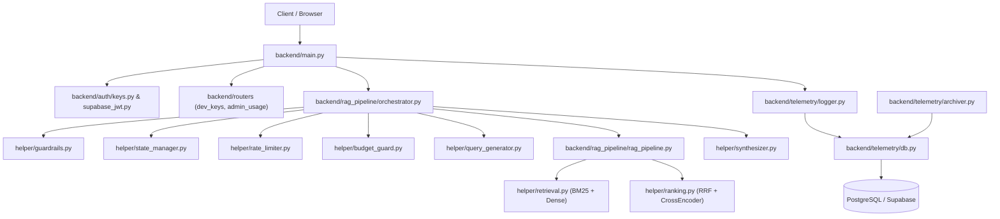

# Codebase Map: Anime Recommender System

## 1. System Overview & Technology Stack

The project is an intelligent anime recommendation platform combining dense semantic embeddings, hybrid lexical/BM25 retrieval, cross-encoder neural reranking, streaming Server-Sent Events (SSE) chat synthesis, and telemetry tracking.

### Technology Stack
- **Backend Language & Runtime:** Python 3.11
- **Backend Frameworks:** FastAPI, Starlette, Pydantic v2, Uvicorn
- **Machine Learning & NLP:** PyTorch (CUDA GPU accelerated), Sentence-Transformers (`all-mpnet-base-v2`, `ms-marco-MiniLM-L-6-v2`), Hugging Face Hub, FastText
- **Databases & Storage:** PostgreSQL / Supabase (PgBouncer transaction pooler & direct session pooler, pgvector, pg_trgm), Upstash Redis (atomic Lua rate limiting and multi-turn session storage), SQLite (HyDE LLM response caching)
- **Deployment Infrastructure:** Modal serverless GPU containers, Docker containers, Docker Compose
- **Frontend Language & Framework:** TypeScript 5.7, React 18, Vite 6, Tailwind CSS 3.4, PostCSS, Lucide React, Supabase JS Client
- **Package Managers:** pip (Python), npm (Node.js)
- **Testing & Tooling:** Pytest 9.1 with pytest-asyncio, HTTPX ASGI in-process client

---

## 2. Directory Layout & Top-Level Inventory

```text
anime_recommender/
├── .github/                      # CI/CD automation workflows (3 files)
│   └── workflows/
│       ├── archive_telemetry.yaml
│       ├── hourly-recommendation.yaml
│       └── update_data.yaml
├── .vscode/                      # Editor configuration (1 file)
├── backend/                      # Core application backend (50 tracked files)
│   ├── auth/                     # HMAC-SHA256 API key authentication and Supabase JWKS verification
│   ├── data_pipeline/            # Raw data ingestion, preprocessing, and vector indexing
│   ├── migrations/               # DDL migrations (strictly protected from automated removal)
│   ├── rag_pipeline/             # Multi-stage retrieval-augmented generation engine
│   │   └── helper/               # Pipeline modules (guardrails, rate limiter, synthesizer, etc.)
│   ├── routers/                  # Modular FastAPI APIRouters (dev keys, admin usage)
│   ├── telemetry/                # Structured event logging, database pool, and monthly Parquet archiver
│   └── main.py                   # Primary FastAPI gateway entry point (Modal serverless target)
├── docs/                         # Architecture guides, mitigation plans, and developer journals (2 tracked files)
├── frontend/                     # React single-page application (71 tracked files)
│   ├── src/
│   │   ├── components/           # UI components (chat, admin, developers, docs, common, layout)
│   │   ├── config/               # Client environment variables and validation
│   │   ├── context/              # React context providers (AuthContext, ThemeContext)
│   │   ├── hooks/                # Custom React hooks (telemetry, preferences, API keys, etc.)
│   │   ├── lib/                  # Shared clients (apiClient, chatStream, supabase, userPreferences)
│   │   ├── routes/               # Page route views (ChatPage, DevelopersPage, Admin pages, etc.)
│   │   └── types/                # TypeScript interface definitions
│   ├── index.html                # HTML mount page
│   ├── package.json              # Frontend dependency manifest
│   ├── tailwind.config.js        # Tailwind CSS configuration
│   ├── tsconfig.json             # TypeScript compiler settings
│   └── vite.config.ts            # Vite bundler configuration
├── scripts/                      # Operational CLI scripts and automation tools (4 tracked files)
│   ├── alert_dispatcher.py       # CI workflow failure alert dispatcher
│   ├── db_keepalive.py           # Supabase connection probe for scheduled workflows
│   ├── manage_keys.py            # Break-glass CLI key generation and revocation tool
│   └── verify_storage_bucket.py  # Supabase Storage bucket verification utility
├── test/                         # Comprehensive automated test suite and benchmarks (38 tracked files)
│   ├── benchmarks/               # SBERT benchmarks and performance workbooks
│   ├── data/                     # Offline evaluation datasets, SQLite cache, and history logs
│   ├── experiments/              # Embedding sweeps and parameter sweep scripts
│   ├── pipeline/                 # Integration test suites for retrieval, guardrails, SSE, and LLMs
│   ├── smoke/                    # End-to-end isolated smoke tests
│   └── hourly_run.py             # Evaluation probe and synthetic query generation script
├── docker-compose.yaml           # Local container orchestration
├── modal_deploy.py               # Modal serverless deployment specification for ModelWorker
├── pytest.ini                    # Pytest discovery configuration
├── requirements.txt              # Production Python dependencies
└── requirements-archive.txt      # Isolated dependencies for monthly telemetry archiver
```

---

## 3. Entry Points & Invocation Surface

### Backend Entry Points
1. **`backend/main.py`**: Primary production FastAPI service. Deployed to Modal serverless hosting. Exposes `/`, `/recommend`, `/admin/recommend`, `/chat`, and mounts routers for `/dev/keys` and `/admin/usage`.
2. **`backend/rag_pipeline/main.py`**: Secondary containerised FastAPI service. Deployed inside Docker container targets. Strictly protected under dual-entrypoint policy.
3. **`modal_deploy.py`**: Modal serverless deployment script defining `ModelWorker` (GPU embedding and cross-encoder inference worker) and `fastapi_app`.
4. **`backend/data_pipeline/run_pipeline.py`**: CLI pipeline for data fetching from Kaggle/AniList, cleaning, embedding generation, and bulk database loading.
5. **`backend/telemetry/archiver.py`**: Telemetry log archiver executable via `python -m backend.telemetry.archiver` in GitHub Actions cron.

### Operational CLI Scripts
1. **`scripts/alert_dispatcher.py`**: Invoked by `.github/workflows/archive_telemetry.yaml` on job failure.
2. **`scripts/db_keepalive.py`**: Invoked by `.github/workflows/update_data.yaml` to ensure Supabase database compute is awake.
3. **`scripts/manage_keys.py`**: Administrator CLI tool for manual break-glass key management.
4. **`scripts/verify_storage_bucket.py`**: Pre-flight verification for Supabase storage buckets.

### Frontend Entry Points
1. **`frontend/src/main.tsx`**: React client application bootstrap, mounting `App.tsx` into DOM `#root`.
2. **`frontend/src/App.tsx`**: Client routing definition mounting `/`, `/chat`, `/developers`, `/docs`, `/admin/telemetry`, `/admin/usage`, `/login`, and `/signup`.

---

## 4. Dependency & Import Graph

### Backend Architecture Graph


### Key Import Relationships
- `backend/main.py` imports `rag_pipeline`, `orchestrator`, `DomainGuardrails`, `DistributedRateLimiter`, `state_manager`, `authenticate_api_key`, `get_jwks_service`, and telemetry modules.
- `backend/rag_pipeline/orchestrator.py` coordinates query guardrails, state management, budget guard, query generation, ranking, and streaming token synthesis.
- `backend/rag_pipeline/rag_pipeline.py` provides both synchronous `rag_pipeline` and asynchronous `async_rag_pipeline`.
- `backend/telemetry/logger.py` uses `ThreadedConnectionPool` from `backend/telemetry/db.py` to decouple telemetry writes from recommendation queries.

---

## 5. Framework Conventions & Core Abstractions

1. **Dual Entrypoints:** Explicitly maintained for deployment isolation (`backend/main.py` for Modal GPU serverless; `backend/rag_pipeline/main.py` for container environments).
2. **FastAPI Routers:** Routers are structured in `backend/routers/` and mounted onto the application root.
3. **Database Migrations:** Located in `backend/migrations/` (`001_bm25_index_and_metadata.py`, `002_telemetry_and_api_keys.py`, `003_llm_usage.py`). Under ground rules, migrations are protected.
4. **Pytest Test Suite:** Located in `test/`, configured with `norecursedirs` excluding build, node, and vendor directories.
5. **Frontend Asset Bundling:** Vite + TypeScript configuration with path aliases and Tailwind CSS utility styling.

---

## 6. CI/CD Workflows, Automation & Scheduled Tasks

1. **`Monthly Telemetry Parquet Archival` (`.github/workflows/archive_telemetry.yaml`):**
   - Scheduled: `0 3 1 * *` (3:00 AM UTC on 1st of month).
   - Installs: `requirements-archive.txt`.
   - Executes: `python -m backend.telemetry.archiver` and `scripts/alert_dispatcher.py` on failure.
2. **`Hourly Anime Recommender Test` (`.github/workflows/hourly-recommendation.yaml`):**
   - Trigger: `workflow_dispatch` (scheduled hourly trigger commented out).
   - Executes: `python test/hourly_run.py`.
   - Records outputs to: `test/data/anime_results.jsonl`.
3. **`Weekly Data Pipeline Update` (`.github/workflows/update_data.yaml`):**
   - Scheduled: `0 3 * * 0` (3:00 AM UTC every Sunday).
   - Executes: `python scripts/db_keepalive.py`, builds `backend/data_pipeline/Dockerfile`, runs `data_pipeline.run_pipeline`, updates Modal volume.

---

## 7. Hand-Maintained, Protected & Immature Files

Per project policy (`NOTE_NON_IMPACTING_FILES.md` and Ground Rules):
- `backend/main.py` and `backend/rag_pipeline/main.py`: Protected dual entrypoints.
- `backend/migrations/`: Database schema migrations (untouchable without explicit user consent).
- `misc/`, `backend/models/anime_fasttext.txt`, empty root `models/`: Untracked directories and vendor artifacts.
- Package markers `backend/rag_pipeline/__init__.py` and `backend/rag_pipeline/helper/__init__.py`: Protected.
- `docs/DEVELOPER_JOURNAL.md`, `ARCHITECTURE.md`, `README.md`, `LICENSE`: Retained documentation.
